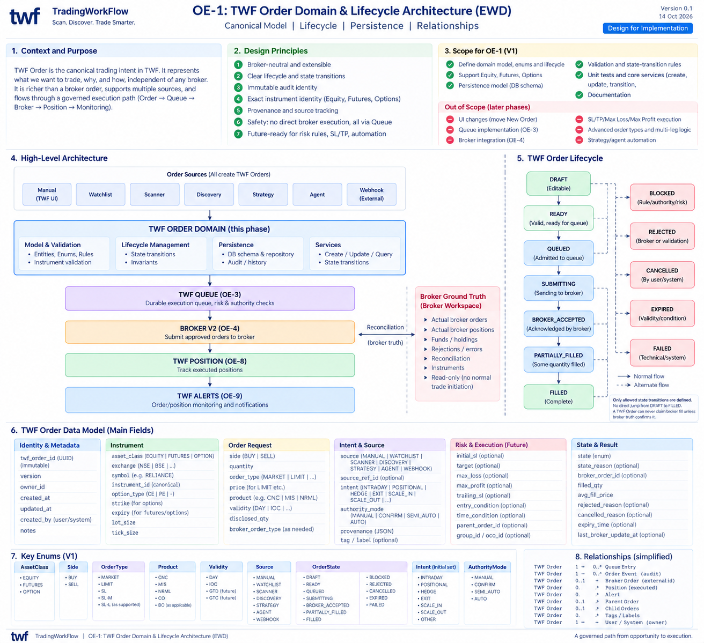

# TWF Order Domain & Lifecycle Architecture

**Program:** OE-1 — Canonical Model, Lifecycle, Persistence & Relationships  
**Status:** OE-1 ACCEPTED / FROZEN (14 October 2026)  
**Version:** 0.1  
**Date:** 14 October 2026

> **Execution principle:** No TWF subsystem may initiate a broker order except through the governed TWF execution path.

---

## 1. Executive Summary

OE-1 defines the canonical TWF Order domain before TWF introduces its durable execution queue. A **TWF Order** is a broker-neutral trading intent owned by TWF. It represents what TWF wants to trade, why it wants to trade, and the exact instrument and request semantics, while remaining independent of any single broker implementation.

The architecture deliberately separates **intent from execution**. Manual trading, Watchlists, Scanner, Discovery, strategies, agents, and future webhooks all create or request TWF Orders. Those orders will later enter **TWF Queue (OE-3)**, pass governance and authority checks, and only then reach **Broker V2 (OE-4)**. Broker truth remains authoritative for broker acceptance, fills, rejections, cancellations, and reconciliation.

> OE-1 does **not** move the New Order UI, implement Queue, or redesign the ticket. It defines the constitution that those later capabilities must obey.

### 1.1 Objectives

- Define a broker-neutral TWF Order entity and immutable identity.
- Support Equity, Futures and Options with exact canonical instrument identity.
- Define lifecycle states, legal transitions and invariants.
- Persist orders and their state/audit history durably.
- Capture provenance so every order can be traced to its source.
- Create a future-safe model for SL, TP, max loss/profit, conditional execution, automation and multi-leg relationships without implementing those features yet.

### 1.2 Non-goals for OE-1

- No New Order UI migration yet (planned for OE-2).
- No execution queue implementation yet (planned for OE-3).
- No Queue → Broker bridge yet (planned for OE-4).
- No TWF Position or Alert lifecycle implementation yet.
- No advanced SL/TP/trailing/conditional execution engine in V1.
- No direct integration from Scanner, Watchlist, webhook, strategy or agent to broker execution.

### 1.3 Architecture EWD



---

## 2. Architectural Principles

1. **Broker-neutral domain.** TWF Order is not a Zerodha, Dhan, Fyers or other broker order DTO. Broker mapping happens only at the execution boundary.
2. **Exact instrument identity.** Equity, Futures and Options must resolve to canonical, unambiguous instrument identity. Plain display symbols are insufficient for derivative execution.
3. **Intent is not execution.** Creating a TWF Order does not mean it was queued, submitted, accepted or filled.
4. **Broker truth is authoritative.** TWF may request execution, but broker acceptance/fill/rejection/cancellation states must come from Broker V2/reconciliation truth.
5. **Governed path only.** No subsystem may bypass TWF Order → TWF Queue → governed execution → Broker V2.
6. **Durable auditability.** Order identity, lifecycle transitions and provenance must survive process restarts.
7. **Safe extensibility.** The V1 model must leave room for future SL/TP, max loss/profit, trailing, conditional orders, parent/child relations and automated authority.
8. **Explicit provenance.** A manual action, Watchlist, Scanner run, DiscoveryCandidate, strategy, agent or webhook must remain identifiable as the source of the order.

---

## 3. TWF Order Lifecycle

The lifecycle intentionally distinguishes **TWF validation**, **queue admission**, **broker submission** and **broker execution**. The exact state names may be adjusted during implementation, but the semantic boundaries are normative.

| State              | Meaning                                                                   | Authority / Truth Source                            |
| ------------------ | ------------------------------------------------------------------------- | --------------------------------------------------- |
| `DRAFT`            | Editable TWF trading intent. Not eligible for execution.                  | TWF / initiating user or subsystem                  |
| `READY`            | Valid and complete enough for queue admission.                            | TWF validation                                      |
| `QUEUED`           | Durably admitted to TWF Queue.                                            | TWF Queue (OE-3)                                    |
| `SUBMITTING`       | Queue has begun broker submission.                                        | TWF Queue / Broker bridge                           |
| `BROKER_ACCEPTED`  | Broker acknowledged the order request.                                    | Broker truth                                        |
| `PARTIALLY_FILLED` | Broker confirms some quantity filled.                                     | Broker truth / reconciliation                       |
| `FILLED`           | Broker confirms complete fill.                                            | Broker truth / reconciliation                       |
| `BLOCKED`          | Cannot progress because rule, risk, authority or dependency blocks it.    | TWF governance                                      |
| `REJECTED`         | Order cannot proceed due validation or broker rejection; reason required. | TWF or broker truth, distinguished by reason/source |
| `CANCELLED`        | Order cancelled by user/system/broker as applicable.                      | TWF or broker truth, source recorded                |
| `EXPIRED`          | Validity or execution condition expired.                                  | TWF / execution policy                              |
| `FAILED`           | Technical/system failure prevented progression.                           | TWF infrastructure                                  |

### 3.1 Lifecycle invariants

- No direct transition from `DRAFT` to `FILLED`.
- `BROKER_ACCEPTED`, `PARTIALLY_FILLED` and `FILLED` cannot be asserted without broker truth.
- `QUEUED` means **durable admission**, not merely in-memory list membership.
- `REJECTED` is semantically different from `FAILED`: rejection is a business/broker decision; failure is a technical/system condition.
- Every terminal or exceptional state must preserve a reason and transition history.
- A TWF Order is never silently rewritten to look as if a different source created it.

### 3.2 Normative lifecycle flow

```text
DRAFT
  ↓
READY
  ↓
QUEUED
  ↓
SUBMITTING
  ↓
BROKER_ACCEPTED
  ↓
PARTIALLY_FILLED
  ↓
FILLED
```

Alternative states such as `BLOCKED`, `REJECTED`, `CANCELLED`, `EXPIRED` and `FAILED` are only reachable through explicitly allowed transitions.

---

## 4. Canonical TWF Order Data Model

The following model is the architectural target. OE-1 implementation should persist the bounded V1 subset required for OE-2/OE-3 while keeping the schema extensible.

| Dimension                 | Representative fields                                                                                                                    | V1 expectation                                                                                    |
| ------------------------- | ---------------------------------------------------------------------------------------------------------------------------------------- | ------------------------------------------------------------------------------------------------- |
| Identity & metadata       | `twf_order_id`, `version`, `owner_id`, `created_at`, `updated_at`, `created_by`, `notes`                                                 | Required core identity and ownership                                                              |
| Instrument                | `asset_class`, `exchange`, canonical `instrument_id`, `symbol`, `option_type`, `strike`, `expiry`, `lot_size`, `tick_size`               | Exact identity required; derivative fields only where applicable                                  |
| Order request             | `side`, `quantity`, `order_type`, `limit_price`, `trigger_price`, `product`, `validity`, `disclosed_qty`                                 | Support current proven broker order forms first                                                   |
| Intent & source           | `source`, `source_ref_id`, `intent`, `authority_mode`, `provenance`, `tags`                                                              | Source required; richer intent fields may be optional in V1                                       |
| Risk & execution (future) | `initial_sl`, `target`, `max_loss`, `max_profit`, `trailing_sl`, `entry_condition`, `time_condition`, parent/group/OCO refs              | Architecturally reserved; not active execution features in OE-1                                   |
| State & result            | `state`, `state_reason`, `broker_order_id`, `filled_qty`, `avg_fill_price`, reject/cancel reason, `expiry_time`, `last_broker_update_at` | State/history foundation required; broker results populated only from later bridge/reconciliation |

### 4.1 Identity rules

- `twf_order_id` is the immutable identity of the TWF Order.
- Broker order IDs are external references, never replacements for `twf_order_id`.
- Canonical instrument identity must be sufficient to distinguish exact derivative contracts.
- Display symbols are presentation data, not execution identity.

### 4.2 Broker-neutrality

The domain must not require broker-specific DTOs, security-token formats, request payloads or broker enum names. Mapping to a broker happens later at the governed execution boundary.

---

## 5. Key Domain Types and Enums

| Type            | Initial values / notes                                                                                                                             |
| --------------- | -------------------------------------------------------------------------------------------------------------------------------------------------- |
| `AssetClass`    | `EQUITY`, `FUTURES`, `OPTION`                                                                                                                      |
| `Side`          | `BUY`, `SELL`                                                                                                                                      |
| `OrderType`     | `MARKET`, `LIMIT` and currently supported order forms; trigger/SL variants can be added without broker coupling                                    |
| `Source`        | `MANUAL`, `WATCHLIST`, `SCANNER`, `DISCOVERY`, `STRATEGY`, `AGENT`, `WEBHOOK`                                                                      |
| `Intent`        | `INTRADAY`, `POSITIONAL`, `HEDGE`, `EXIT`, `SCALE_IN`, `SCALE_OUT`, `OTHER` — extensible and not all mandatory in V1                               |
| `AuthorityMode` | `MANUAL`, `CONFIRM_REQUIRED`, `SEMI_AUTO`, `AUTO` — advanced modes may remain inactive initially                                                   |
| `OrderState`    | `DRAFT`, `READY`, `QUEUED`, `SUBMITTING`, `BROKER_ACCEPTED`, `PARTIALLY_FILLED`, `FILLED`, `BLOCKED`, `REJECTED`, `CANCELLED`, `EXPIRED`, `FAILED` |

Product and validity should remain broker-neutral where practical, with exact broker-capability mapping deferred to the execution boundary.

---

## 6. Source and Provenance Model

A central value of TWF Orders is that execution can be traced back to its originating workflow. Provenance must be explicit and durable, not reconstructed later from logs.

| Source      | Example provenance                                                            |
| ----------- | ----------------------------------------------------------------------------- |
| `MANUAL`    | User, UI location, originating workspace, optional notes                      |
| `WATCHLIST` | Watchlist id/name, selected row/instrument, timestamp                         |
| `SCANNER`   | Scanner mode, run id, template id, filters, exact evidence snapshot/reference |
| `DISCOVERY` | DiscoveryCandidate id, lifecycle state, evidence/context references           |
| `STRATEGY`  | Strategy id/version, signal id, parameters                                    |
| `AGENT`     | Agent/service id, policy/version, decision reference                          |
| `WEBHOOK`   | External integration id, signed request/event id, received timestamp          |

> Source provenance never grants execution authority by itself. All sources converge on the same governed **Order → Queue → Broker** path.

---

## 7. Relationships

| Relationship                | Cardinality / meaning                                                                            |
| --------------------------- | ------------------------------------------------------------------------------------------------ |
| TWF Order → Queue Entry     | `1 → 0..n` over lifecycle/history; active queue semantics finalized in OE-3                      |
| TWF Order → Order Event     | `1 → n` immutable/auditable transition and operational events                                    |
| TWF Order → Broker Order    | `0..1+` external broker identifiers depending later amendment/retry design; must remain explicit |
| TWF Order → Position        | `0..1+` executed position linkage finalized in OE-8                                              |
| TWF Order → Alert           | `0..n` monitoring/operational alerts finalized in OE-9                                           |
| TWF Order → Parent/Children | Optional future relationship for scale, hedge, multi-leg or conditional workflows                |
| TWF Order → Owner           | Exactly one owner/account scope                                                                  |

---

## 8. Persistence, Events and Audit

OE-1 should establish persistence that is sufficient to recover TWF Orders and reconstruct their lifecycle after restart. State transitions should be auditable rather than merely overwriting the current-state row without history.

- **Current-state record.** Fast access to the latest canonical order state and request.
- **Immutable order/event history.** Transition, actor/subsystem, timestamp, reason and relevant correlation identifiers.
- **Idempotency/correlation hooks.** Reserve stable identifiers for later Queue and Broker submission deduplication.
- **No secret material.** Order persistence must not contain broker credentials or access tokens.
- **Owner scoping.** Every query/update must respect current TWF ownership/account boundaries.

### 8.1 Minimum event examples

| Event                 | Example purpose                                                         |
| --------------------- | ----------------------------------------------------------------------- |
| `ORDER_CREATED`       | Canonical TWF Order created from a source.                              |
| `ORDER_UPDATED`       | Editable `DRAFT` fields changed; changes captured with actor/timestamp. |
| `ORDER_VALIDATED`     | Order passes/fails readiness validation.                                |
| `STATE_TRANSITIONED`  | Lifecycle state transition with from/to/reason.                         |
| `PROVENANCE_ATTACHED` | Source/evidence reference associated with the order.                    |

The event model may later be extended by OE-3/OE-4/OE-5 for queue admission, broker submission and reconciliation.

---

## 9. Validation and State Transition Rules

Validation in OE-1 is **domain validation**, not live broker validation. Broker-specific capability checks belong to the execution bridge, although OE-1 should preserve enough canonical information to perform those checks later.

- Quantity must be positive and compatible with the canonical instrument constraints known to TWF.
- Derivative orders require exact expiry/strike/option type as applicable.
- A `LIMIT` order requires a valid limit price; unsupported combinations must be rejected explicitly.
- Instrument identity cannot be silently changed after an order leaves editable `DRAFT` without explicit lifecycle semantics.
- Only allowed state transitions are accepted; invalid transitions return typed errors.
- Terminal-state mutation must be tightly controlled and auditable.
- Every rejection/failure/cancellation must preserve a machine-readable category plus human-readable reason where useful.

---

## 10. OE-1 Domain Services

OE-1 should expose a small set of application/domain services that later OE phases can reuse rather than allowing callers to manipulate database rows directly.

| Service capability       | Responsibility                                                                          |
| ------------------------ | --------------------------------------------------------------------------------------- |
| `CreateOrder`            | Create canonical TWF Order from validated broker-neutral request and source provenance. |
| `GetOrder / ListOrders`  | Owner-scoped retrieval.                                                                 |
| `UpdateDraftOrder`       | Modify only fields that are legal while editable.                                       |
| `ValidateForReadiness`   | Check whether order is complete and valid enough to become `READY`.                     |
| `TransitionOrder`        | Apply one legal lifecycle transition atomically with audit event.                       |
| `Attach/QueryProvenance` | Persist and retrieve originating workflow references.                                   |
| `OrderHistory`           | Return chronological immutable transition/event history.                                |

---

## 11. Boundary with Broker V2

Broker V2 remains the broker-facing authority and ground-truth adapter. OE-1 must not move broker submission logic into the TWF Order entity or repository.

- TWF Order is broker-neutral and can exist before any broker is selected/connected.
- Broker-specific symbol/token mapping is an execution concern, not the canonical order identity itself.
- Broker order IDs are results/references, not the identity of the TWF Order.
- The Broker workspace remains the faithful view of actual broker orders, positions, holdings, funds, errors and reconciliation.
- Normal future TWF trade initiation will move to TWF Orders, but OE-1 does not remove the current Broker New Order UI.

---

## 12. Relationship to the OE Roadmap

| Phase                                 | Dependency on OE-1                                                                                |
| ------------------------------------- | ------------------------------------------------------------------------------------------------- |
| OE-2 — Existing New Order → TWF Order | Uses OE-1 contracts/services to create a TWF Order instead of directly initiating a broker order. |
| OE-3 — TWF Queue Foundation           | Admits `READY` TWF Orders durably and governs progression.                                        |
| OE-4 — Queue → Broker V2              | Maps approved queued orders to exact Broker V2 submissions.                                       |
| OE-5 — Broker Reconciliation          | Updates TWF state from broker truth.                                                              |
| OE-6 — TWF Orders Workspace           | Presents TWF Orders and lifecycle to the operator.                                                |
| OE-7 — Audit / Logging                | Builds richer operational/trade audit on top of OE-1 event foundation.                            |
| OE-8 — TWF Positions                  | Links executed/adopted trades to richer managed positions.                                        |
| OE-9 — TWF Alerts                     | Monitors Orders/Queue/Positions.                                                                  |
| OE-10+                                | Adds advanced order semantics, external intake and hardening.                                     |

---

## 13. OE-1 Acceptance Criteria

1. A canonical TWF Order can be created for Equity, Futures and Options without embedding broker-specific DTO semantics.
2. Exact canonical instrument identity is preserved and derivative identity is unambiguous.
3. Source/provenance is durably attached and owner-scoped.
4. Lifecycle transitions are typed, validated and audited; illegal transitions are rejected.
5. Broker-truth-only states cannot be asserted by ordinary TWF callers.
6. Current state and transition history survive restart/persistence round trips.
7. No runtime path introduced by OE-1 can directly submit to a broker.
8. The model is extensible for later SL/TP/max-loss/max-profit/trailing/conditional/parent-child capabilities without implementing them in V1.
9. Automated tests cover valid/invalid transitions, persistence, provenance, instrument validation and broker-truth invariants.
10. Architecture documentation and README status remain consistent with implemented capability.

---

## 14. Decisions to Settle During OE-1 Implementation

- Exact canonical field representation for instruments and whether to reference an existing instrument identity/value object.
- Whether TWF Order uses optimistic versioning and how concurrent draft updates are rejected.
- Whether order events are append-only rows, an existing ledger abstraction, or another repository-native mechanism.
- Precise transition matrix for cancellation/expiry/failure from intermediate states.
- Which order types/products/validity values belong in V1 versus future extensions.
- How broker-neutral product/validity fields map to broker capabilities later without polluting the canonical model.
- How `source_ref` / provenance references existing Scanner/Watchlist entities without hard coupling domain packages.

---

## 15. Architectural Bottom Line

> OE-1 creates the stable domain boundary that lets every future TWF capability request a trade without receiving direct broker authority.

With OE-1 accepted, OE-2 can reuse the current proven **Select Instrument → Ticket → Preview** experience and have it create a TWF Order. OE-3 can then introduce the durable execution queue. This sequence deliberately proves the foundation before advanced trade-management features are added.

---

## 16. OE-1 Implementation Decisions (14 October 2026)

- `twf.orders` is the non-executional domain/service boundary. It uses the existing SQLAlchemy `Base`, session factory, owner UUID (`users.id`) and Alembic chain. `broker_order_intents` and the existing Broker New Order flow remain unchanged. The owner-scoped `OrderService` encapsulates the narrow SQLAlchemy repository operations (create/get/list/update/history and CAS) rather than adding a separate generic repository framework. There is no OE-1 API or broker/Queue adapter.
- `twf_order_id` is a new immutable UUID, unrelated to any eventual broker order ID. The order snapshots the canonical instrument UUID and exact derivative underlying UUID, expiry, strike/right, lot size and tick size. The existing `InstrumentIdentity` also carries provider-native references, so the order contract intentionally stores its provider-neutral subset rather than the whole provider object. The `from_canonical` projection provides that mapping without persisting native provider IDs. OE-2 must use a resolved canonical identity; a display symbol alone is never sufficient.
- V1 requests cover BUY/SELL, positive unit quantity, MARKET/LIMIT, INTRADAY/DELIVERY/CARRY_FORWARD and DAY/IOC. LIMIT requires a positive price; MARKET forbids one. Derivative readiness enforces lot multiples, tick multiples for LIMIT and no DELIVERY product. These are structural checks, not live broker capability or funds checks. SL/TP, conditional, multi-leg and automated authority modes remain reserved.
- The owner-scoped service creates DRAFT orders; only draft terms and notes can change. Originating provenance, identity and authority mode are immutable in OE-1. `validate_for_readiness` returns typed violations plus the resulting order version and audits the result. DRAFT/BLOCKED → READY revalidates in the same transaction. Ordinary transitions may cancel/reject DRAFT, block/reject/cancel/expire/fail READY, or move BLOCKED back to READY/cancel/expire. Terminal states have no exit. Every exceptional transition requires a machine-readable reason code and message. Queue (`QUEUED`, `SUBMITTING`) and broker-truth (`BROKER_ACCEPTED`, `PARTIALLY_FILLED`, `FILLED`) states are typed but have no reachable OE-1 transition or privileged API; future OE phases must add distinct authority boundaries.
- Each mutation uses an expected-version compare-and-swap and commits current state with its append-only event row(s) in one transaction. Draft update events retain exact before/after values for edited fields. Per-order event sequence establishes deterministic history, including creation, draft updates, validation and transitions. The `ORDER_CREATED` event contains the complete originating provenance (the attachment event is folded into creation). Source references are structured, bounded JSON without hard foreign keys to Scanner/Watchlist/etc. No broker credentials or tokens are stored.
- Migration `0023_twf_orders` adds the current-state and event tables. It upgrades, downgrades and re-upgrades on SQLite. PostgreSQL migration validation depends on an available test database.

### 16.1 OE-1 adversarial hardening (F1–F8)

- **Exchange expiry date (F1):** `InstrumentIdentity.expiry_date` is the explicit, strictly typed exchange-calendar `date` used by `OrderInstrument.from_canonical`. The legacy discovery `expiry` instant remains for existing consumers and is never converted to UTC and truncated to derive an order expiry. A canonical derivative without `expiry_date` is rejected. The same 29 October NSE expiry survives midnight IST, 15:30 IST, the equivalent UTC instant, and persistence round-trip.
- **Exact canonical contract (F2):** `OrderService.create_order` accepts only the `CreateOrder` intent; it does not accept a caller-supplied `InstrumentIdentity`. An internally issued `TrustedCanonicalInstrumentAuthority` binds a server-side `CanonicalInstrumentResolver` and resolves the proposed canonical UUID against a trusted instrument reference before creation. Directly constructed or unissued authority objects are rejected by `OrderService`. The service rejects an absent or mismatched UUID, ambiguous identity, incomplete derivative contract, mismatched asset class, or any request field that differs from the resolved identity. The resolver is injected at the trusted application composition boundary; OE-2 must wire an authoritative server-side reference, not construct it from the order payload or a caller-provided identity. There is no OE-1 public creation API. The resolved object is projected to provider-neutral fields; native security identifiers and tokens are not persisted. Exact exchange expiry date, lot/tick, strike and CE/PE remain required for derivatives.
- **Owner, actor and source (F3/F7):** `OrderService` binds to `OrderContext` from the existing authenticated `User` and `AuthSession`; each operation rechecks the persisted session, active user, owner link, revocation and expiry. `from_authenticated_session` fixes source to `MANUAL`; an ordinary caller cannot choose a subsystem label by passing `source` or an arbitrary `source_ref`. An internal subsystem issuer validates the originating event/run reference and owner before it can mint a sealed origin for `from_trusted_subsystem`. The resulting context binds both source and exact source reference; creation rejects a request that contradicts either. Future Scanner, Watchlist, webhook, strategy and agent adapters must supply their own trusted owner-scoped reference validators at composition time. `source_ref` is traceability, never authentication. Actor (who performed the operation), source (where intent arose) and lifecycle authority are separate: delegated user actions still audit `USER:<owner UUID>`, and neither source nor actor labels confer Queue or broker-truth transition authority.
- **Payload and numeric safety (F4/F8):** Creation accepts the exact `CreateOrder` class and exact nested request classes, rebuilds and validates that schema, and persists only its allowed fields. View/subclass lifecycle, owner, broker and version fields are rejected. Quantity and derivative lot size are positive integers at most `1,000,000,000`. Limit price, derivative strike and tick size are positive finite Decimals at most `1,000,000,000`, with at most eight decimal places; no rounding occurs. Provenance allows at most 16 references (keys 1–64 characters, values 1–512), a source reference of at most 256 characters, notes of at most 2,000, and correlation IDs of at most 128. Trigger/disclosed quantities and tags are not active OE-1 terms.
- **Concurrency and audit integrity (F5/F6):** Expected-version CAS remains the mutation guard. SQLite `BUSY`, `LOCKED`, and `BUSY_SNAPSHOT` during a mutation become `RETRYABLE_CONCURRENCY_CONFLICT`; unrelated database errors propagate. The order table has a unique `(twf_order_id, owner_id)` pair, and the event table has a composite FK to that pair. A mismatched event owner fails at the database boundary. Current state and append-only events commit or roll back together; history is read in per-order sequence order.
- **Idempotency carry-forward:** OE-1 does not claim create idempotency. OE-2/OE-3 must define the request/event key and uniqueness scope before retries can create orders automatically; OE-11 external intake must require a stable source-event identity. Repeated manual orders remain permitted. No runtime Queue, broker execution, or reconciliation path is introduced here.

## 17. OE-1 Acceptance and Freeze (14 October 2026)

**Status: ACCEPTED / FROZEN.** Independent adversarial review, F1–F8 hardening, final trust-boundary remediation, and final acceptance review are complete. The accepted foundation covers canonical broker-neutral Equity/Futures/Options Order contracts, trusted exact instrument identity and owner/source context, the bounded lifecycle with Queue/Broker authority guards, optimistic concurrency, migration, durable current state, and atomic ordered audit history.

This freeze does **not** implement Queue or workers, Queue → Broker V2 handoff, a TWF Orders UI, migration of the existing Broker New Order flow, TWF Positions/Alerts lifecycles, SL/TP or max profit/loss automation, webhook execution, or a finalized create/intake idempotency policy. OE-2 has **NOT STARTED**; OE-3 and later phases remain planned.

Carry-forward observations:

- Live PostgreSQL validation was **NOT_RUN** because a test environment was unavailable. SQLite validation and offline PostgreSQL migration SQL do not establish live PostgreSQL behavior.
- Repository-wide mypy retains pre-existing, unrelated errors in unchanged test files; OE-1 changed-source type checking passed.
- Create/intake idempotency keys and uniqueness scope remain for OE-2/OE-3, with stable source-event identity required for OE-11 external intake.
- OE-2 must wire the existing New Order flow to an authoritative trusted server-side canonical instrument resolver, not order-payload identity.
- Future Watchlist, Scanner, Discovery, Strategy, Agent, and Webhook adapters must issue trusted owner-bound source/origin contexts and validate their originating event references.
